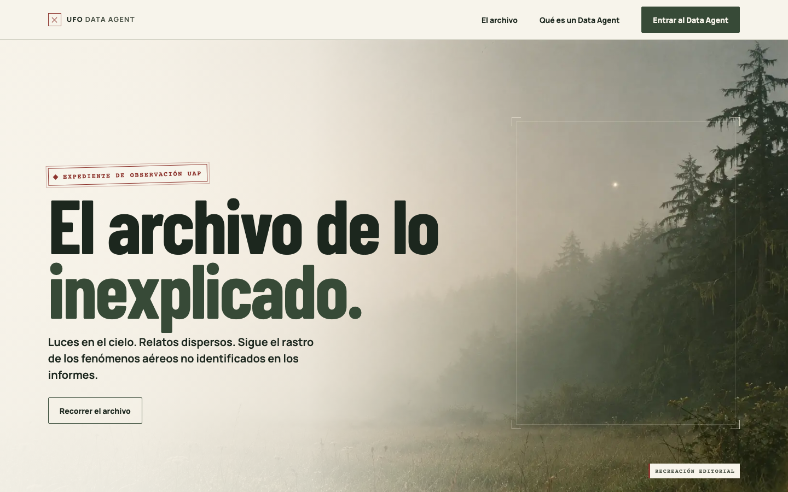
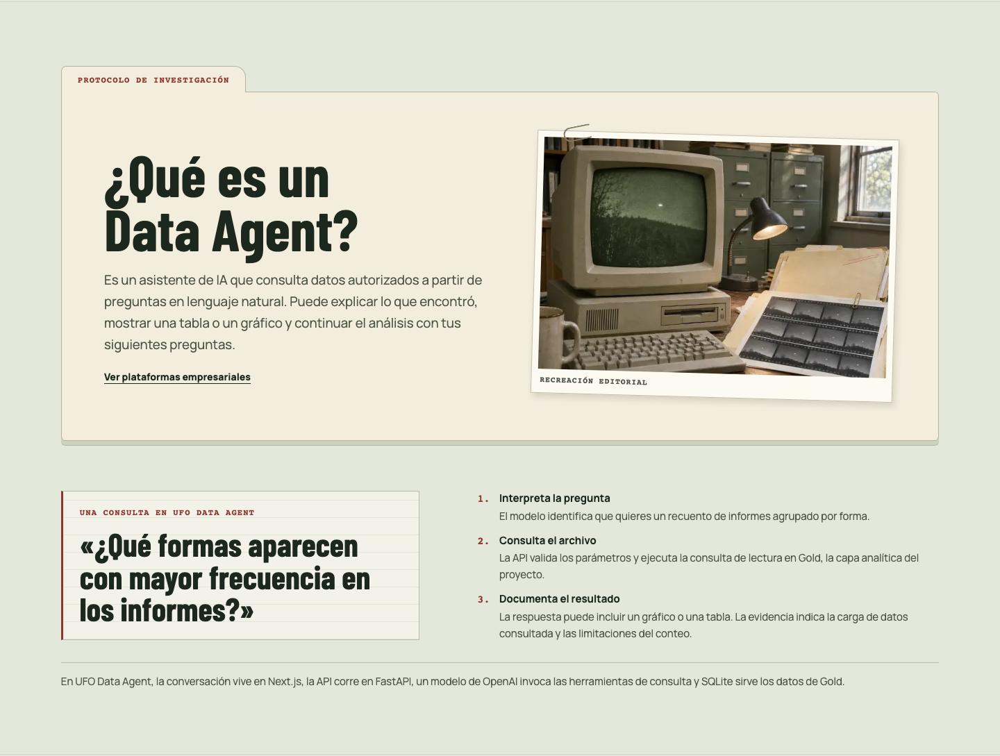

# Prototipo de UFO Data Agent

Portada del [UFO Data Agent](https://github.com/marcor0311/UFO-Data-Agent), un caso de investigación sobre la exploración conversacional de informes de fenómenos aéreos no identificados. La experiencia presenta el archivo en tema claro, recorre los testimonios y sus fuentes, explica cómo se analiza una pregunta y termina con el acceso al agente.

Las fotografías del recorrido son recreaciones editoriales. El agente consulta agregados y evidencia de la capa Gold del proyecto.

## Portada del archivo UAP

## Recorrido por los informes

## Protocolo de investigación

Un Data Agent interpreta preguntas en lenguaje natural, usa herramientas para consultar fuentes autorizadas y presenta resultados con contexto. El ejemplo de la portada muestra cómo UFO Data Agent interpreta un recuento por forma, ejecuta una consulta validada sobre Gold y devuelve un resultado con su evidencia.

## Referencias empresariales

La sección compara experiencias de análisis conversacional y servicios que aportan contexto a los agentes. [Data agent en ChatGPT Work](https://openai.com/index/put-data-to-work/) · [Claude Data](https://support.claude.com/en/articles/17454700-get-started-with-claude-data) · [Genie Agents](https://docs.databricks.com/aws/en/genie-agents/) · [Tableau Knowledge](https://help.tableau.com/current/online/en-gb/tableau_knowledge_about.htm).

