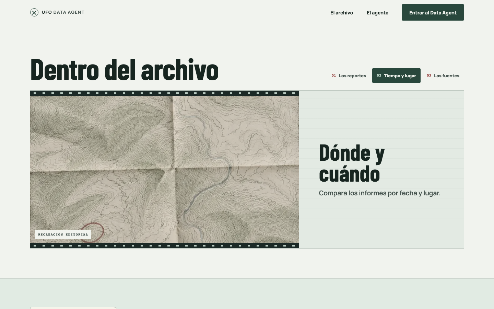
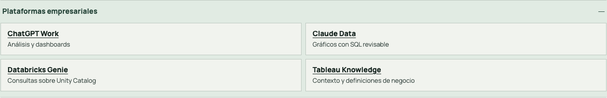

# Prototipo de UFO Data Agent

Galería de [UFO Data Agent](https://github.com/marcor0311/UFO-Data-Agent). Los datos provienen de Gold y las fotografías son recreaciones editoriales.

## Portada del archivo UAP

## Recorrido por los informes

## Protocolo de investigación

El agente convierte una pregunta sobre los informes en una consulta a Gold y muestra el resultado con su evidencia.

## Referencias empresariales

La sección compara experiencias de análisis conversacional y servicios que aportan contexto a los agentes. [Data agent en ChatGPT Work](https://openai.com/index/put-data-to-work/) · [Claude Data](https://support.claude.com/en/articles/17454700-get-started-with-claude-data) · [Genie Agents](https://docs.databricks.com/aws/en/genie-agents/) · [Tableau Knowledge](https://help.tableau.com/current/online/en-gb/tableau_knowledge_about.htm).

